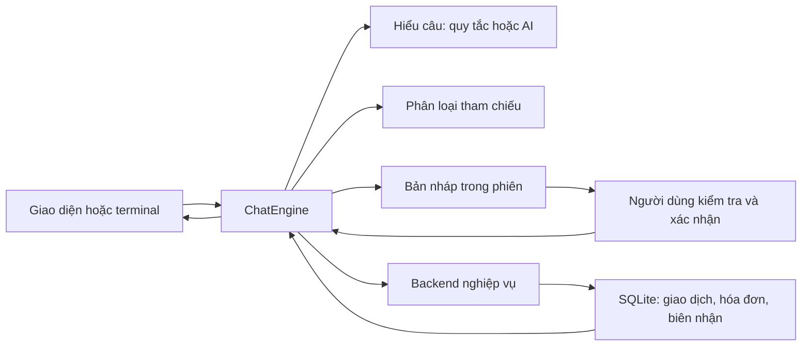

# Giải thích từng khối code phần Chat

Tài liệu dành cho Đức Duy để học, sửa và giải thích với nhóm. Mã khối như E03 được ghi ngay trong source; dùng Ctrl+F tìm mã đó. Giải thích theo chức năng và hàm thay vì học thuộc từng dòng.

## 1. Đọc theo thứ tự nào?

Đọc `models.py` → `parser.py` → `engine.py` → `storage.py` → `app.py`. Sau đó đọc `services.py`, `ai.py`, `demo.py` và tests. `__main__.py` là cửa vào terminal, còn `app.py` là cửa vào trình duyệt. Hai cách cùng dùng một `ChatEngine`.

Điểm quan trọng nhất: hiểu một câu không đồng nghĩa được ghi dữ liệu. `send()` tạo/sửa nháp; `confirm()` mới chuẩn bị lệnh ghi; `commit()` ở database mới thêm giao dịch.

## 2. Cú pháp Python xuất hiện trong dự án

| Cú pháp | Ý nghĩa trong chương trình |
|---|---|
| `import`, `from ... import ...` | Lấy chức năng thư viện hoặc file khác; không sao chép code vào nhau |
| `class`, `def`, `self` | Gom dữ liệu/hành vi thành đối tượng, khai báo hàm; self là đối tượng đang xử lý |
| `dict`, `list`, `set` | Dữ liệu theo tên trường, danh sách có thứ tự, tập giá trị không trùng |
| `@dataclass` | Tạo lớp chứa dữ liệu và hàm khởi tạo; giảm code lặp |
| `field(default_factory=...)` | Tạo dict/list/ID mới cho từng đối tượng, không dùng chung một list nháp |
| `if/elif/else`, `for`, `while` | Chọn nhánh, lặp phần tử, lặp qua các kỳ tháng |
| `return` | Kết thúc hàm và trả kết quả cho bên gọi |
| `try/except` | Bắt lỗi để hỏi lại hoặc giữ trạng thái thay vì làm app dừng |
| `with` | Quản lý tài nguyên; mở/đóng kết nối hoặc bảo đảm transaction hoàn tất/rollback |
| `None` | Chưa có giá trị; khác 0 hoặc chuỗi rỗng |
| `dict.get()` | Lấy trường an toàn khi có thể thiếu |
| `a \| b` với dict | Ghép dict, trường ở b ghi đè a; dùng ưu tiên lỗi cụ thể |
| `?` trong SQL | Chỗ truyền tham số riêng, không nối câu người dùng thành lệnh SQL |
| `Protocol` | Mô tả những hàm một mô-đun cần cung cấp; giúp đổi cách triển khai |
| `patch` trong test | Tạm thay hành vi hàm để mô phỏng lỗi; hết khối thì khôi phục |

## 3. `models.py`: dữ liệu và quy tắc chung

### M01 — Hằng số và hàm tiện ích

`CATEGORIES` ánh xạ mã dùng trong máy với nhãn tiếng Việt. Mã `food` ổn định dù giao diện đổi cách hiển thị. `WRITE_INTENTS` liệt kê hai thao tác có ghi dữ liệu; `INTENTS` thêm hai thao tác chỉ đọc.

`local_today()` lấy ngày UTC+7, không dùng giờ mặc định máy để tránh ngày tương đối sai. `money()` biến 45000 thành `45.000đ`; chỉ định dạng, không thay giá trị tiền trong database.

### M02 — `Parsed`

Đây là kết quả hiểu một câu: `intent`, các `fields`, lỗi `issues` và cờ `multiple`. Ví dụ “Ăn trưa 45k” tạo ý định ghi chi, nội dung và 45000. Nó không có hàm lưu dữ liệu nên không thể tự ghi một giao dịch.

### M03 — `Draft`

`id` là mã bản nháp mới bằng UUID; `version` tăng khi sửa. `fields` giữ thông tin đã có, `issues` giữ lỗi cần hỏi lại. `to_dict()` dùng `asdict` để đổi thành dict rồi lưu JSON trong phiên. Hai nháp không dùng chung dict nhờ `default_factory`.

### M04 — `validate()` và `valid_month()`

Kiểm tra tiền phải đúng kiểu int, dương, không quá giới hạn kỹ thuật 1.000 tỷ; không chấp nhận bool chỉ vì Python coi bool gần với int. Nội dung phải là chuỗi không rỗng, tối đa 300 ký tự. Ngày chi không ở tương lai. Danh mục nằm trong sáu mã. Hóa đơn có ngày lặp 1–31 và tháng bắt đầu hợp lệ. Yêu cầu thống kê phải có tháng/năm.

`valid_month()` ghép `-01` để dùng bộ kiểm tra ngày của Python và kiểm tra lại định dạng YYYY-MM. Hàm trả một bảng lỗi theo tên trường để giao diện biết hỏi gì. Cùng quy tắc được gọi trong Chat và ở nơi ghi, vì người gọi backend có thể bỏ qua giao diện.

## 4. `parser.py`: hiểu câu bằng quy tắc

### P01 — `fold()` và các biểu thức chính quy

`fold()` bỏ dấu và đổi chữ thường để “Ăn trưa” và “ăn trưa” so khớp được. Chỉ dùng bản bỏ dấu để nhận mẫu; nội dung người dùng được giữ tiếng Việt.

`MONEY` nhận số kèm k/nghìn/triệu/đồng; `DATE` nhận dd/mm/yyyy; `MONTH` nhận tháng và năm. Biểu thức chính quy là mẫu ký tự, không phải mô hình AI. Vì vậy không được nói nó hiểu mọi cách diễn đạt.

### P02 — `parse_money()` và `parse_date()`

`parse_money()` tìm số có đơn vị, chuẩn hóa dấu phân cách, nhân hệ số 1000 hoặc một triệu. `Decimal` tránh lỗi làm tròn số thực. Trả cả vị trí khớp để bỏ tiền khỏi nội dung và phát hiện nhiều khoản. Giá trị sai trả lỗi, không tự đổi âm thành dương.

`parse_date()` kiểm tra ngày đầy đủ bằng `date`, xử lý hôm nay/hôm qua và từ chối tương lai. Thiếu ngày không tự lưu: engine sẽ đề xuất hôm nay trên nháp để người dùng xác nhận. Ngày không hợp lệ giữ trạng thái cần sửa.

### P03 — `detect_intent()`

Ưu tiên nhận thao tác “đã trả” cần chuyển nghiệp vụ; tiếp đó ngoài phạm vi, xem hóa đơn, tạo lịch, xem tổng rồi ghi chi. Thứ tự quan trọng: câu tạo lịch có số tiền không nên bị hiểu thành khoản đã chi. Không hiểu thì trả None để giải thích phạm vi hoặc gọi bộ AI tùy chọn.

### P04 — `month_fields()`

Đọc tháng/năm, tháng này hoặc tháng trước. Nếu “tháng 10” chưa có năm, giữ `month_number=10` và chưa có tháng hoàn chỉnh. Khi lượt sau là “2026”, ghép thành `2026-10`. Đây là ví dụ cần trạng thái hội thoại, không thể hiểu từng câu hoàn toàn riêng lẻ.

### P05 — `description_from()`

Bỏ tiền, ngày, cụm tạo lịch và từ điều khiển như “sửa thành”, rồi dọn khoảng trắng. Câu “đổi thành 50k” không được thay nội dung “Ăn trưa” thành “đổi thành”. Câu tiền mơ hồ “Cà phê 45” vẫn giữ “Cà phê”, còn tiền phải hỏi lại.

### P06 — `RuleInterpreter.parse()`

Nhận câu, ngày thử và trường hiện tại. Nếu đang có nháp, ưu tiên ý định của nháp để “45k” trở thành bổ sung tiền. Tạo `Parsed`, trích trường, đánh dấu nhiều khoản, nhận chọn danh mục bằng tay và các trường hóa đơn/thống kê.

Hàm chỉ trả thay đổi của lượt này; không xóa những trường cũ không được đề cập. Tiền mơ hồ đặt lỗi `amount_vnd`; nhãn chọn tay ghi `category_source=user`. Bộ này có giới hạn, luôn có form nhập tay để hoàn thành những trường chưa hiểu.

## 5. `engine.py`: phần chính Duy giải thích với nhóm

### E01 — Khởi tạo, `snapshot()`, `errors()`, `reply()`

`ChatEngine.__init__()` nhận store, phiên, ngày và các mô-đun có thể thay. Đây là tiêm phụ thuộc: test có thể đưa dịch vụ giả lỗi, nhóm có thể đưa phân loại thật.

`snapshot()` tải phiên mới nhất, tính các lỗi và `can_confirm`. `errors()` ghép kiểm tra nghiệp vụ với lỗi hiểu câu cụ thể. `reply()` thêm câu bot vào lịch sử và lưu phiên, không ghi bảng giao dịch.

### E02 — `send()`

Hàm vào chính cho mọi câu Chat. Kiểm tra độ dài; lưu lượt người dùng; nếu có lệnh pending thì chỉ cho kiểm tra kết quả. Nhận “xác nhận lưu” chính xác, hủy, giữ/hủy để đổi yêu cầu, câu ngoài phạm vi và yêu cầu đã trả chưa hỗ trợ.

Nếu đang ghi chi mà người dùng hỏi thống kê, giữ nháp và hỏi có hủy để chuyển không. “Ừ” không thành xác nhận. Gọi bộ hiểu câu trong try/except; nếu lỗi giữ nháp và hướng dẫn nhập tay. Câu có nhiều khoản yêu cầu gửi riêng, không tự cộng.

Khi cần nháp mới, tạo `Draft`. Với khoản chi thiếu ngày, đưa ngày hiện tại và nguồn `default_today`. Sau đó `merge()` nhận những trường mới để cập nhật.

### E03 — `merge()`

Xóa lỗi cũ chỉ cho trường vừa được sửa, ghép dữ liệu mới, tăng version. Nếu nội dung thay đổi và nhãn chưa được người dùng chọn tay, gọi lại phân loại. Nhãn trả về không thuộc sáu mã bị bỏ. Lỗi phân loại không làm chương trình gán bừa “Khác”; người dùng phải chọn.

Ví dụ tiền từ 45k sửa thành 50k vẫn giữ nội dung. Nội dung từ “vé xe” đổi thành “xe đồ chơi” phải phân loại lại. Danh mục đã chọn tay được ưu tiên.

### E04 — `edit()`

Điểm vào cho form. So mã và version với nháp hiện tại, từ chối form cũ hoặc thao tác trong lúc đang lưu. Chỉ cho thay trường nằm trong danh sách cho phép; người dùng không được sửa `state`, `pending` hoặc khóa ghi bằng form. Gọi `merge()` để xử lý chung.

### E05 — `evaluate()`

Nếu có lỗi, chuyển `collecting` và hỏi. Nếu nháp ghi đã đủ, chuyển `awaiting_confirmation` và hiện bản nháp; chưa gọi commit. Nếu là yêu cầu đọc, gọi tổng hợp hoặc danh sách hóa đơn. Lỗi đọc giữ yêu cầu để thử lại, không báo tổng bằng 0. Đọc thành công thì xóa yêu cầu tạm và quay về idle.

### E06 — `confirm()`

Xác minh bản nháp vẫn đúng mã/version và hợp lệ. Khóa ghi là tổ hợp mã nháp và version. Lưu `pending` vào SQLite trước khi gọi backend. Nếu ứng dụng dừng sau khi gửi, mở lại vẫn biết cần kiểm tra lệnh nào.

### E07 — `submit()`

Gửi lệnh ghi qua backend. Lỗi `ValueError` là backend từ chối rõ: giữ nháp cho sửa, không nói thành công. Lỗi khác như timeout là chưa rõ đã ghi hay chưa: giữ nguyên pending và chuyển `checking_result`. Thành công thì chuyển `complete()`.

### E08 — `retry()`

Đọc biên nhận theo khóa. Có biên nhận thì hiển thị kết quả cũ. Không có thì gửi lại **cùng khóa và cùng nội dung**. Việc này an toàn nhờ database chống lặp; không phải do nút trên giao diện. Mỗi lần người dùng bấm chỉ kiểm tra/thử một lượt, không chạy vòng lặp vô hạn.

### E09 — `complete()`

Chỉ được gọi với biên nhận thành công; xóa nháp/pending, lưu `last_receipt`, trả mã giao dịch/hóa đơn. Đây là chỗ duy nhất báo “Đã lưu”. Tạo lịch có câu nhắc “chưa ghi chi” để tránh hiểu nhầm.

## 6. `storage.py`: dữ liệu và chống trùng

### S01 — `encode()`, `__init__()`, `connection()`

`encode()` tạo JSON có thứ tự khóa ổn định, giữ tiếng Việt. Khởi tạo tạo thư mục và bảng nếu thiếu, không xóa database. Bảng sessions chứa hội thoại/nháp; expenses chứa chi đã lưu; bills chứa lịch; paid_periods chứa trạng thái mẫu; operations chứa khóa/biên nhận.

`connection()` mở SQLite, dùng Row để đọc theo tên cột; with bảo đảm commit khi thành công, rollback khi có lỗi, cuối cùng đóng kết nối. Kết nối mới cho mỗi thao tác tránh dùng chung đối tượng kết nối giữa các thread.

### S02 — `load_session()` và `save_session()`

Load trả phiên đã có hoặc cấu trúc rỗng. Save dùng INSERT…ON CONFLICT để thêm hoặc cập nhật cùng mã phiên. Nháp và lịch sử là JSON, không tính vào tổng chi.

### S03 — `commit()` và `operation_status()`

Chỉ nhận hai ý định ghi. Lấy danh sách trường nghiệp vụ cần thiết, tạo SHA-256 cho nội dung để phát hiện cùng khóa nhưng dữ liệu khác. `BEGIN IMMEDIATE` khóa thao tác ghi để hai yêu cầu đồng thời không cùng chèn.

Nếu khóa đã có và nội dung giống, trả biên nhận cũ. Nếu khác, từ chối. Nếu chưa có, validate lần nữa, INSERT bản ghi và INSERT biên nhận trong cùng transaction. Một trong hai lỗi thì cả hai rollback. `operation_status()` đọc biên nhận để khôi phục sau mất phản hồi.

SHA-256 ở đây dùng so nội dung, không phải mã hóa bí mật. Khóa chống lặp không tự coi hai giao dịch mới cùng số tiền là trùng; hai bản nháp khác nhau là hai thao tác khác nhau.

### S04 — `summary()` và `expenses()`

`summary()` dùng SQL SUM/COUNT/GROUP BY cho tháng và danh mục yêu cầu. Các giá trị điều kiện truyền bằng tham số `?`, không nối câu Chat thành SQL. `expenses()` đọc danh sách để hiện ở tab dữ liệu.

Đây là phép tính xác định trên các dòng đã commit. Bộ AI không tham gia cộng tiền, lịch sử chat không được dùng làm sổ chi tiêu.

### S05 — `due_bills()`

Backend tham chiếu tạo các kỳ trong phạm vi từ tháng bắt đầu đến tháng của ngày cuối cửa sổ. `calendar.monthrange` cho số ngày tháng; chọn min(ngày gốc, số ngày tháng). Bỏ kỳ đã trả, giữ mọi kỳ quá hạn và kỳ sắp tới trong 7 ngày. Gắn trạng thái và sắp xếp theo ngày/mã.

Kỳ được tính để đọc; chưa có giao diện nghiệp vụ thanh toán trong gói này. Nếu Phúc có module thật, thay `backend.due_bills()`, Chat không cần biết thuật toán mới. Hàm này không gửi nhắc ngoài ứng dụng.

### S06 — `seed_paid_period()`

Chỉ chuẩn bị trạng thái giả lập để kiểm tra bộ lọc kỳ đã trả. Không phải thao tác xác nhận thanh toán cho người dùng. Không tạo/link khoản chi nên không được dùng thay module thanh toán thực tế.

## 7. `services.py`: nối với nhóm

`Classifier` và `Backend` là Protocol, nêu tên hàm và dữ liệu cần trao đổi. Không phải máy chủ chạy mạng. Python cho phép truyền đối tượng khác có các hàm tương ứng vào engine.

`KeywordClassifier.classify()` là baseline thử: xử lý phản ví dụ xe đồ chơi, sách học, rồi so nhóm từ khóa. Chỉ một nhóm rõ mới trả nhãn; không nhóm hoặc nhiều nhóm trả None. Đây không phải mô hình học máy và không thay phần đánh giá thật của Cường.

Khi ghép Cường, tạo adapter có `classify(description)` trả mã hoặc None. Nếu module trả suggested/needs_choice/error, adapter chuyển suggested thành mã, needs_choice thành None, error thành exception. Engine đã có đường chọn tay khi lỗi. Cách gọi hiện tại đồng bộ, chưa có tác vụ phân loại nền; không có kết quả chạy nền đến muộn trong bản này. Version vẫn ngăn thao tác UI cũ.

Khi ghép Dũng/Phúc, đối tượng backend phải cung cấp commit, operation_status, summary, due_bills. Không viết lại SQL hoặc tính lịch bên trong engine. Bản nháp có thể tiếp tục dùng store riêng cho phiên, nhưng dữ liệu nghiệp vụ phải cùng một nguồn đã chốt của nhóm.

## 8. `ai.py`: bộ nối tùy chọn, không quyết định ghi

### A01 — `HybridInterpreter.__init__()` và cấu hình

Nhận URL đầy đủ, model và khóa từ biến môi trường; không có khóa thật trong source. Chấp nhận HTTPS hoặc HTTP localhost. `configured_interpreter()` trả RuleInterpreter nếu thiếu URL/model; có đủ thì tạo HybridInterpreter. Dòng chế độ trên giao diện cho biết đang dùng gì.

### A02 — `parse()` gọi dịch vụ

Thử bộ quy tắc trước. Câu đã biết hoặc nháp đang hoạt động tiếp tục dùng quy tắc. Chỉ câu chưa xác định ý định mới gửi API. Payload có system instruction và câu người dùng; timeout 15 giây; giới hạn phản hồi khoảng 100KB. Đọc `choices[0].message.content`, yêu cầu là JSON.

Prompt yêu cầu trích đoạn bằng chứng, không đưa số tiền/ngày không có trong câu, không thực thi. Điều này không được tin tuyệt đối: còn có kiểm tra ở A03 và lớp ghi.

### A03 — `from_evidence()`

Kiểm tra kiểu dict, danh sách ý định và tên trường cho phép. Mọi bằng chứng phải là chuỗi con nguyên văn trong câu gốc. Tiền/ngày/tháng lại qua bộ chuẩn hóa quy tắc. Nhận số tiền chưa hiểu được thì không tự bịa cách chuyển. Kết quả chỉ là `Parsed`, còn phải hỏi thiếu và xác nhận.

Không có đo độ chính xác của API trong lần bàn giao. Test chỉ mô phỏng giao thức và việc từ chối bằng chứng bịa. Người dùng cần cấu hình dịch vụ thật rồi đánh giá riêng.

## 9. `app.py`: giao diện Streamlit

### U01 — Khởi tạo và giữ mã phiên

Tạo tiêu đề, lấy session từ query parameter trên URL. Chưa có thì tạo UUID. Database giữ dữ liệu nháp nên tải lại cùng URL có thể đọc tiếp, không phụ thuộc toàn bộ vào session_state của Streamlit. Đường dẫn dữ liệu lấy từ biến môi trường để test dùng thư mục tạm.

### U02 — Sidebar

Chọn database thường/demo, chọn ngày thật/giả lập, thêm bộ mẫu hoặc mở hội thoại mới. Mở hội thoại mới không xóa giao dịch. Tạo interpreter theo môi trường; cấu hình URL sai hiển thị lỗi thay vì lộ khóa.

### U03 — Hiển thị hội thoại và các trạng thái chờ

`snapshot()` lấy trạng thái mới nhất. Mỗi lịch sử được render qua `st.chat_message`; chỉ hiển thị tối đa 60 tin gần nhất để giao diện gọn, database vẫn giữ lịch sử. Pending thì có nút kiểm tra kết quả. Đổi ý định thì có hai nút giữ/hủy-chuyển.

### U04 — Form và xác nhận

Form có khóa ghép draft id/version để bản mới không dùng widget cũ. Nội dung/tiền/ngày/nhãn hoặc ngày lặp/tháng bắt đầu được nhập. Form submit gọi edit, chưa commit. Nhãn chỉ đánh dấu người dùng khi họ đổi lựa chọn; đổi nội dung mà giữ nhãn máy cũ thì engine phân loại lại.

Nút Xác nhận gửi đúng id/version. Nút Hủy đi qua send. `st.rerun()` chạy lại giao diện để đọc trạng thái mới; vì mọi lệnh ghi có khóa nên không dựa việc chạy lại này để quyết định ghi. `st.chat_input` nhận câu mới; khóa khi pending.

### U05 — Tab dữ liệu

Đọc danh sách giao dịch, tổng tháng và danh sách kỳ cần trả từ backend. Đây là cách người xem kiểm chứng trước xác nhận chưa có bản ghi. Chưa có CRUD hoặc thanh toán thật trong tab này.

## 10. `demo.py`, `__main__.py` và các file cấu hình

`seed_demo()` thêm ba giao dịch và ba lịch bằng khóa cố định `demo-v1:...`. Gọi lại cùng dữ liệu trả biên nhận cũ. Kỳ điện được đánh dấu đã trả bằng fixture để test danh sách. Đó là dữ liệu mô phỏng, không phải sổ tài chính nhất quán của người thật.

`__main__.py` dùng argparse đọc tham số `--db`, `--today`, `--session`, `--seed-demo`. Tạo store/engine rồi lặp input → engine.send → print. “thoát” kết thúc. `if __name__ == '__main__'` bảo đảm main chỉ chạy khi thực thi module, không chạy khi import.

`__init__.py` đánh dấu package. `requirements.txt` cố định Streamlit để chạy giao diện. `.gitignore` không đưa môi trường, dữ liệu hoặc khóa vào version control. `.vscode/settings.json` chỉ cách tìm tests/interpreter; `.vscode/launch.json` chỉ cách F5 chạy terminal/tests/Streamlit, không chứa nghiệp vụ.

## 11. `tests`: đọc và giải thích bằng chứng

### K01 — `setUp()`, `draft()`, `confirm()`

Mỗi ca có TemporaryDirectory và SQLite riêng, ngày 10/11/2026 cố định. `addCleanup` dọn sau test. Các helper lấy nháp và xác nhận giúp tránh lặp thao tác trong từng ca.

### K02 — T01–T11

Kiểm tra không ghi trước xác nhận; hỏi tiền/nội dung; tiền sai; ngày; danh mục; sửa nháp; hủy và đổi ý định. Assert kiểm tra cả dữ liệu thực lưu, không chỉ câu trả lời đẹp. T09 giữ version cũ để kiểm chứng xác nhận lỗi thời bị từ chối.

### K03 — T12–T19

Seed dữ liệu, đối chiếu tổng, kỳ rỗng, lỗi đọc, lịch ngày 31, trạng thái đã trả và chọn tay khi phân loại lỗi. Patch tạo lỗi để chứng minh chương trình không bịa số 0 hoặc nhãn.

### K04 — T20 và các ca chống trùng

Hàm giả `lost()` gọi commit thật rồi ném TimeoutError: database đã có dòng nhưng engine chưa thấy biên nhận. Tạo engine mới cùng session để mô phỏng khởi động lại, retry lấy kết quả cũ. Kiểm tra số dòng vẫn là 1.

Các ca bổ sung kiểm tra cùng khóa/khác dữ liệu bị từ chối; bốn thread cùng khóa chỉ một dòng; pending không cho hủy; bản nháp sống qua restart; form cũ bị từ chối; nhãn tay không bị ghi đè; seed không trùng. Kiểm tra nhiều thread ở đây là tầng commit, không phải chứng minh có hệ thống nhiều người cùng sửa hội thoại.

### K05 — Kiểm tra AI

Kiểm tra bằng chứng bịa bị từ chối và bằng chứng có thật được chuẩn hóa. Mock urlopen tạo phản hồi giống giao thức; không gọi mạng. Kiểm tra dịch vụ lỗi giữ nháp. Không suy từ các test này ra chất lượng một model thật.

### `test_ui.py`

AppTest chạy file Streamlit, gửi câu, bấm xác nhận, kiểm tra database và khởi tạo AppTest mới cùng URL để đọc lại lịch sử. Ca thứ hai thay nội dung bằng form, kiểm tra nhãn cập nhật, rồi hủy không ghi. Đây là kiểm thử widget/luồng, không phải ảnh chụp đánh giá thẩm mỹ giao diện.

## 12. Bài giải thích mẫu khoảng hai phút cho Duy

“Phần của em là điều phối hội thoại. Khi người dùng nhập ăn trưa 45k, bộ hiểu câu trả về các trường chứ chưa lưu. Engine giữ một bản nháp có mã và phiên bản, hỏi thêm khi thiếu và gọi mô-đun phân loại. Nếu người dùng sửa, phiên bản tăng để nút xác nhận cũ không còn tác dụng. Khi người dùng xác nhận, engine lưu một lệnh chờ và gửi sang backend. Backend kiểm tra lại, ghi giao dịch và biên nhận trong cùng transaction. Nếu mất phản hồi, engine tra lại cùng khóa nên không ghi hai lần. Thống kê lấy từ database, không lấy từ tin nhắn. Em có backend và phân loại tham chiếu để chạy độc lập; khi ghép nhóm chỉ thay các điểm nối. Test đã kiểm tra luồng và lỗi mô phỏng, chưa chứng minh độ chính xác AI thật.”

Tự kiểm tra: vì sao bản nháp không được tính vào tổng? Vì sao khóa nút chưa đủ chống trùng? Vì sao AI không có hàm ghi SQL? Vì sao tạo lịch chưa phải khoản đã chi? Tìm câu trả lời ở M03, E06–E08, S03 và S05 trước khi trình bày.
