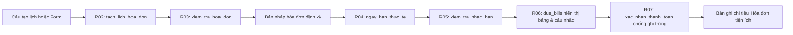

# Giải thích từng khối code phần Nhắc hạn hóa đơn định kỳ

Tài liệu dành cho Xuân Phúc để nắm vững cấu trúc, chỉnh sửa và giải thích trực tiếp với nhóm và giảng viên. Mã khối như `R01`, `R04` được gắn ngay trong comment của file `smart_money_bot_bill_reminder.py`; bạn có thể nhấn `Ctrl+F` trong VS Code để tìm đến đúng khối đó.

## 1. Đọc theo thứ tự nào?

Đọc `classifier.py` (để hiểu cách tách số tiền và chuẩn hóa tiếng Việt) → đọc `smart_money_bot_bill_reminder.py` theo thứ tự từ `R01` đến `R07` → đọc `test_bill_reminder.py` (`K01` đến `K04`) → cuối cùng xem phần kịch bản tương tác trong `smart_money_bot_bill_reminder.html`.

Điểm quan trọng nhất cần nhớ khi bảo vệ: **tạo lịch hóa đơn định kỳ chưa phải là một khoản đã chi**, và **ngày lặp gốc (`due_day = 31`) không bao giờ bị sửa thành `30`** khi đi qua các tháng thiếu. Chỉ khi người dùng bấm xác nhận đã thanh toán ở `R07` thì hệ thống mới sinh ra đúng một bản ghi chi tiêu.

## 2. Cú pháp Python xuất hiện trong mô-đun

| Cú pháp | Ý nghĩa trong chương trình |
| :--- | :--- |
| `import calendar, re` | Nạp thư viện lịch chuẩn để tính số ngày trong tháng và thư viện biểu thức chính quy để tách mẫu câu |
| `from datetime import date` | Làm việc với đối tượng ngày (`YYYY-MM-DD`) và tính khoảng cách ngày bằng phép trừ `due_date - today` |
| `try ... except ImportError` | Nạp hàm `classify` và `_fold` từ `classifier.py`; nếu chạy độc lập khi chưa có file kia thì tự dùng hàm dự phòng mà không bị sập chương trình |
| `re.compile(...)` | Biên dịch sẵn mẫu biểu thức chính quy một lần ở đầu file để tìm ngày lặp và tháng bắt đầu nhanh hơn |
| `calendar.monthrange(year, month)[1]` | Trả về số ngày tối đa của tháng đó (ví dụ: tháng 11 trả về `30`, tháng 2 năm nhuận trả về `29`, năm thường trả về `28`) |
| `min(due_day, last_day)` | Lấy giá trị nhỏ hơn giữa ngày lặp gốc và ngày cuối tháng để không bao giờ tạo ra ngày không hợp lệ như `31/11` |
| `isinstance(x, int) and not isinstance(x, bool)` | Kiểm tra một giá trị là số nguyên thật sự; loại trừ `True`/`False` vì trong Python kiểu `bool` là lớp con của `int` |
| `set(...)` | Chuyển danh sách các tháng đã trả (`paid_months`) thành tập hợp để kiểm tra một kỳ tháng đã đóng tiền hay chưa với tốc độ tức thì |
| `dict.get("key")` | Đọc giá trị từ từ điển an toàn mà không gây lỗi `KeyError` khi trường đó chưa được truyền vào |
| `(due_date - today).days` | Lấy số nguyên biểu thị số ngày còn lại đến hạn (dương là chưa đến hạn, `0` là hôm nay, âm là đã quá hạn) |

## 3. `smart_money_bot_bill_reminder.py`: dữ liệu, tách lịch và kiểm tra hợp lệ

### R01 — Biểu thức chính quy `_RE_DUE_DAY`, `_RE_START_MONTH`, `_RE_YYYY_MM`

`_RE_DUE_DAY` tìm các cụm như `"hạn ngày 5"`, `"ngày lặp 20"`, `"hàng tháng ngày 15"` và dùng nhóm đặt tên `(?P<day>\d{1,2})` để lấy con số ngày. Phần `(?![/-]\d)` ở cuối giúp phân biệt ngày lặp hàng tháng (`ngày 5`) với một ngày đầy đủ (`5/12/2026`).

`_RE_START_MONTH` tìm cụm `"bắt đầu tháng 12/2026"` hoặc `"từ tháng 11/2026"` để tách tháng (`m`) và năm (`y`). `_RE_YYYY_MM` kiểm tra chuỗi tháng bắt đầu có đúng định dạng chuẩn 4 chữ số năm và 2 chữ số tháng từ `01` đến `12` hay không.

### R02 — `tach_lich_hoa_don(text, today=None)`

Hàm này nối tiếp trực tiếp với `classifier.py`. Khi người dùng gõ câu `"Tiền mạng 200k hạn ngày 5 mỗi tháng, bắt đầu tháng 12/2026"`, hàm thực hiện theo 3 bước:

1. Dùng `_fold()` bỏ dấu câu nhập rồi chạy `_RE_DUE_DAY` và `_RE_START_MONTH` để lấy `due_day = 5` và `start_month = "2026-12"`. Nếu câu không nói tháng bắt đầu, hàm mặc định lấy tháng của `today` và đánh dấu `start_month_mac_dinh = True`.
2. Xóa phần chữ chỉ ngày lặp và tháng bắt đầu vừa tìm được khỏi câu gốc (thay bằng khoảng trắng) để con số `5` hay `12/2026` không bị hiểu nhầm thành số tiền.
3. Gửi phần câu còn lại (`"Tiền mạng 200k"`) sang hàm `classify()` của `classifier.py` để lấy số tiền `200000` và tên hóa đơn `"Tiền mạng"`, sau đó chuyển qua `R03` kiểm tra hợp lệ.

### R03 — `kiem_tra_hoa_don(record)`

Đóng vai trò giống hệt `kiem_tra_ban_ghi()` bên `classifier.py`. Hàm kiểm tra 4 điều kiện bắt buộc của một lịch hóa đơn:

- `name` không được rỗng.
- `amount_vnd` phải là số nguyên dương (`> 0`) và không phải kiểu `bool`.
- `due_day` phải là số nguyên từ `1` đến `31`.
- `start_month` phải khớp mẫu `YYYY-MM`.

Nếu thiếu hoặc sai bất kỳ trường nào, tên trường đó được đưa vào `truong_thieu` và `trang_thai` đặt là `"can_bo_sung"` để giao diện hỏi thêm. Chỉ khi `truong_thieu` rỗng thì `trang_thai` mới chuyển sang `"cho_xac_nhan"`. Hàm cũng đồng bộ cả tên khóa tiếng Anh (`name`, `amount_vnd`, `due_day`) của `app.py` và tiếng Việt (`ten`, `so_tien`, `ngay_lap`) của `classifier.py`.

## 4. Thuật toán tính ngày hạn thực tế và xét trạng thái nhắc nhở

### R04 — `ngay_han_thuc_te(year, month, due_day)`

Giải quyết trường hợp biên quan trọng nhất trong báo cáo phân rã: **hóa đơn đặt ngày lặp `31` đi qua các tháng ngắn (`28, 29, 30` ngày)**.

Thay vì sửa trực tiếp `due_day` của hóa đơn thành `30` (làm tháng 12 bị sai theo), hàm giữ nguyên `due_day = 31` trong dữ liệu gốc và chỉ tính ngày thực tế cho tháng đang xét bằng `min(due_day, calendar.monthrange(year, month)[1])`:

- Tháng 11/2026: `monthrange(2026, 11)[1]` bằng `30` → `min(31, 30)` trả về `2026-11-30`.
- Tháng 12/2026: `monthrange(2026, 12)[1]` bằng `31` → `min(31, 31)` tự động trả về `2026-12-31`.
- Tháng 02/2026 (năm thường): trả về `2026-02-28`; tháng 02/2028 (năm nhuận): trả về `2028-02-29`.

### R05 — `kiem_tra_nhac_han(bill, today=None)`

Đây là hàm lõi quyết định trạng thái hiển thị và việc có phát thông báo nhắc hay không tại ngày `today`:

1. **Kiểm tra kỳ bắt đầu:** Nếu tháng hiện tại (`cycle_month`) nhỏ hơn `start_month`, trả về ngay trạng thái `"chua_bat_dau"` và `can_nhac = False`.
2. **Ưu tiên trạng thái Đã thanh toán:** Nếu hóa đơn đã có cờ `da_tra` / `is_paid` hoặc tháng hiện tại đã nằm trong `paid_months`, trả về ngay `"da_thanh_toan"` và dừng nhắc (`can_nhac = False`), bất kể ngày hiện tại là trước hay sau ngày hạn.
3. **Tính khoảng cách ngày `days_left = (due_date - today).days` cho hóa đơn chưa trả:**
   - `days_left < 0`: Trạng thái `"qua_han"`, bật `can_nhac = True`, báo số ngày trễ `-days_left`.
   - `days_left == 0`: Trạng thái `"den_han_hom_nay"`, bật `can_nhac = True`.
   - `days_left in (1, 3)`: Trạng thái `"nhac_truoc_1_ngay"` hoặc `"nhac_truoc_3_ngay"`, bật `can_nhac = True` đúng theo yêu cầu mục tiêu `O5` trong báo cáo.
   - `1 < days_left <= 7`: Trạng thái `"sap_den_han"` (hiển thị trong danh sách 7 ngày cần chuẩn bị tiền nhưng `can_nhac = False` để không gửi thông báo dồn dập ở ngày thứ 2, 4, 5, 6, 7).
   - `days_left > 7`: Trạng thái `"chua_den_han"`, `can_nhac = False`.

### R06 — `due_bills(bills, today=None)`

Hàm gom kết quả của toàn bộ danh sách hóa đơn để trả về đúng cấu trúc mà `app.py` (dòng 85: `st.dataframe(store.due_bills(today)["items"])`) sử dụng:

- `items`: Danh sách các hóa đơn đã bắt đầu áp dụng kèm đầy đủ trạng thái, ngày hạn thực tế và số ngày còn lại.
- `reminders`: Danh sách các chuỗi câu nhắc cần hiển thị ngay lên đầu màn hình (chỉ gồm các khoản có `can_nhac == True`).
- `total_due_vnd`: Tổng số tiền của các hóa đơn chưa thanh toán trong kỳ.

### R07 — `xac_nhan_thanh_toan(bill, today=None, paid_amount=None)`

Giải quyết bài toán **chống ghi trùng khoản chi khi bấm xác nhận nhiều lần** và **chuyển hóa đơn thành giao dịch chi tiêu**:

- Trước tiên, hàm kiểm tra xem kỳ `cycle_month` (`YYYY-MM`) đã có trong `paid_months` (hoặc `da_tra == True`) hay chưa. Nếu đã có, hàm trả về ngay `(False, None, "Hóa đơn ... đã thanh toán, không tạo chi trùng")` và thoát.
- Nếu chưa trả, hàm thêm `cycle_month` vào `paid_months`, bật `da_tra = True`, đồng thời tạo ra đúng một `dict` bản ghi giao dịch chuẩn của `classifier.py` (`so_tien`, `ngay`, `noi_dung`, `danh_muc = "Hóa đơn tiện ích"`, `trang_thai = "da_xac_nhan"`) để chuyển sang bộ lưu trữ giao dịch.

## 5. `test_bill_reminder.py`: đọc và giải thích bằng chứng kiểm thử

- **K01 (`T01–T06`):** Kiểm tra luồng tách câu tiếng Việt và hàm `kiem_tra_hoa_don`. Chứng minh câu thiếu tiền hoặc thiếu ngày lặp luôn bị chặn ở trạng thái `can_bo_sung`, và kiểu `bool` (`True`) không lọt qua bước kiểm tra số tiền nguyên dương.
- **K02 (`T07–T08`):** Kiểm tra `ngay_han_thuc_te` với ngày lặp `31` đi qua tháng 11 (`30/11`), tháng 12 (`31/12`), tháng 2 năm thường (`28/02`) và tháng 2 năm nhuận (`29/02`).
- **K03 (`T09–T15`):** Giữ cố định ngày `today = date(2026, 11, 12)` để kiểm chứng từng mốc `days_left` (`+3`, `+2`, `+1`, `0`, `-2`), hóa đơn đã trả và hóa đơn bắt đầu ở tháng tương lai (`2026-12`).
- **K04 (`T16–T17`):** Kiểm tra hàm `due_bills` cộng tổng đúng các khoản chưa trả và hàm `xac_nhan_thanh_toan` chặn hoàn toàn lần bấm xác nhận thứ hai.

## 6. Bài giải thích mẫu khoảng hai phút cho Phúc khi bảo vệ

“Phần của em là mô-đun Quản lý và Nhắc hạn hóa đơn định kỳ không dùng AI, nối tiếp với bộ phân loại `classifier.py` và giao diện `app.py` của nhóm. Khi người dùng nhập câu tạo lịch như *Tiền mạng 200k hạn ngày 5 mỗi tháng*, hàm `tach_lich_hoa_don` ở khối `R02` tách ngày lặp và tháng bắt đầu trước, rồi gọi `classifier.py` để lấy số tiền và tên hóa đơn, sau đó kiểm tra đủ 4 trường bắt buộc ở `R03` mới cho phép xác nhận. Khi tính ngày hạn hàng tháng ở `R04`, em dùng `calendar.monthrange` lấy `min` giữa ngày lặp gốc và số ngày tối đa của tháng đó, nhờ vậy hóa đơn ngày 31 sẽ có hạn 30/11 ở tháng 11 nhưng sang tháng 12 vẫn tự động quay lại ngày 31/12 mà không bị mất cấu hình gốc. Ở bước xét nhắc hạn `R05`, hệ thống ưu tiên kiểm tra trạng thái đã thanh toán trước để dừng nhắc; nếu chưa trả thì tính khoảng cách ngày từ `today` đến ngày hạn thực tế để phát cảnh báo đúng vào các mốc trước 3 ngày, trước 1 ngày, ngày đến hạn và khi quá hạn. Cuối cùng, khi người dùng bấm xác nhận đã đóng tiền ở `R07`, hệ thống ghi nhận kỳ tháng vào `paid_months` để chặn bấm đúp hai lần và sinh ra đúng một bản ghi chi tiêu thuộc nhóm *Hóa đơn tiện ích*.”

**Câu hỏi tự kiểm tra trước khi lên trình bày:**

1. Vì sao không được sửa thẳng `due_day = 31` thành `30` khi gặp tháng 4, 6, 9, 11? (Xem `R04`).
2. Vì sao hóa đơn còn `2 ngày` vẫn hiển thị là *Sắp đến hạn* trên bảng nhưng cờ `can_nhac` lại bằng `False`? (Xem `R05` — chỉ phát thông báo nhắc ở mốc 3 ngày, 1 ngày, hôm nay và quá hạn để tránh làm phiền người dùng mỗi ngày).
3. Làm thế nào hệ thống ngăn việc bấm nút thanh toán hai lần tạo ra hai khoản chi trùng nhau? (Xem `R07` và ca kiểm thử `T17`).
4. Khi tách câu `"Tiền mạng 200k hạn ngày 5"`, vì sao phải xóa cụm `"hạn ngày 5"` trước khi gửi sang `classifier.py`? (Xem `R02` — để tránh con số `5` gây cảnh báo số tiền mơ hồ).
